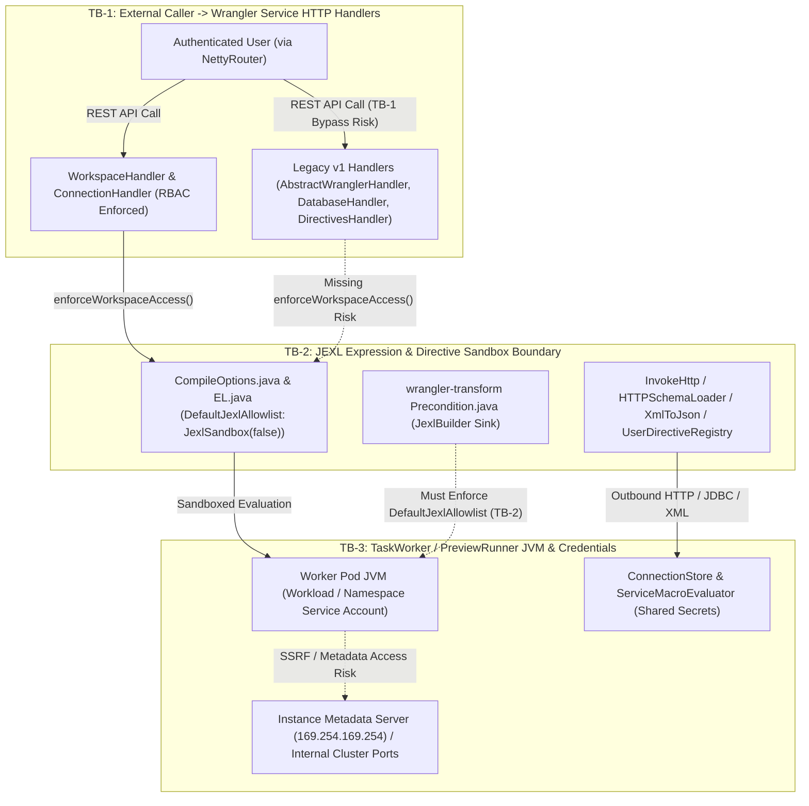

# Security Threat Model: Wrangler Data Prep Service & Directives (`data-integrations/wrangler`)

**Scope:** `https://github.com/data-integrations/wrangler` (branches `develop`, `release/*`)  
**Components:** `wrangler-service`, `wrangler-core`, `wrangler-transform`, `wrangler-api`, `wrangler-storage`

---

## 1. Asset Definition & Scope

This threat model defines the trust boundaries, untrusted user-controlled inputs, runtime identities, known sink classes, and security invariants for **Wrangler** (`data-integrations/wrangler`), the interactive data-preparation system service (`dataprep-service` / `TaskWorker`) and pipeline transform plugin.

- **JEXL Expression Evaluator & Directive Compiler (`wrangler-core`: `EL.java`, `CompileOptions.java`, `DefaultJexlAllowlist.java`, `RecordConditionFilter.java`, `ColumnExpression.java`, `UserDirectiveRegistry.java`, `InvokeHttp.java`, `HTTPSchemaLoader.java`, `XmlToJson.java`)**:
  - Parses and executes user-authored Wrangler recipes, Apache Commons JEXL expressions (`set-column`, `filter-rows-on`, `send-to-error`), custom user directives (`UserDirectiveRegistry`), HTTP directives (`InvokeHttp`, `HTTPSchemaLoader`), and XML/JSON parsers (`XmlToJson`).
- **Wrangler Pipeline Transform Plugin (`wrangler-transform`: `Wrangler.java`, `Precondition.java`)**:
  - Executes Wrangler recipes and JEXL precondition expressions (`Precondition.java`) during pipeline stage validation, preview (`PreviewRunner` / `TaskWorker`), and batch/streaming runs.
- **Wrangler System Service & Connection Handlers (`wrangler-service`, `wrangler-storage`: `AbstractWranglerHandler.java`, `WorkspaceHandler.java`, `DirectivesHandler.java`, `RecipeHandler.java`, `ConnectionHandler.java`, `DatabaseHandler.java`, `BigQueryHandler.java`, `GCSHandler.java`, `S3Handler.java`, `KafkaHandler.java`, `ServiceMacroEvaluator.java`, `UserDirectivesCollector.java`, `ConnectionStore.java`)**:
  - Exposes REST endpoints under `/v3/namespaces/system/apps/dataprep/services/service/methods/**` (and namespace-scoped v2 routes) for interactive data wrangling, workspace management, connection testing/sampling, and macro evaluation.

### Related Component Threat Models

- **CDAP Core Runtime (`cdapio/cdap`)**: `cdap/THREAT_MODEL.md`
- **CDAP Build & Packaging (`cdapio/cdap-build`)**: `cdap-build/THREAT_MODEL.md`
- **CDAP Web UI & Node.js Proxy (`cdapio/cdap-ui`)**: `cdap-ui/THREAT_MODEL.md`
- **CDAP Kubernetes Operator (`cdapio/cdap-operator`)**: `cdap-operator/THREAT_MODEL.md`
- **Hydrator Core & Database Plugins (`cdapio/hydrator-plugins`)**: `hydrator-plugins/THREAT_MODEL.md`

---

## 2. Trust Boundaries & Runtime Identities

### 2.1 Trust Boundaries

- **TB-1 (External Caller -> `wrangler-service` Workspace & Namespace RBAC Boundary)**:
  - Every HTTP endpoint in `wrangler-service` (including all subclasses of `AbstractWranglerHandler`: `DatabaseHandler`, `BigQueryHandler`, `GCSHandler`, `S3Handler`, `KafkaHandler`, `DirectivesHandler`, `RecipeHandler`, `ConnectionHandler`, `WorkspaceHandler`) MUST enforce namespace and workspace RBAC (`enforceWorkspaceAccess` / `@AuthEnforce`) before reading/writing connections, sampling databases, or executing recipes.
- **TB-2 (User Recipe / Precondition Expression -> JVM Code Execution Boundary)**:
  - Wrangler expressions run inside shared `TaskWorker` and `PreviewRunner` JVMs.
  - Every `JexlEngine` instance across `wrangler-core`, `wrangler-service`, and `wrangler-transform` (including `Precondition.java` and v1 `DirectivesHandler` / `RecipeHandler`) MUST use the fail-closed `JexlSandbox(false)` allowlist (`DefaultJexlAllowlist.java`) enabled by default (`feature.wrangler.jexl.allowlist.enabled=true`), blocking arbitrary `new()` constructor invocations on non-allowlisted classes.
- **TB-3 (Wrangler Directives & Connection Handlers -> Internal Network & Secret Store Boundary)**:
  - Outbound HTTP directives (`InvokeHttp`, `HTTPSchemaLoader`) and database handlers (`DatabaseHandler`) must not act as SSRF proxies to `169.254.169.254` or internal cluster ports, must not allow SQL injection or unsafe JDBC driver properties, and must not leak decrypted Secure Store macros in API responses (`ServiceMacroEvaluator`, `ConnectionStore`).

---

## 3. Untrusted User-Controlled Inputs & Entry Points

| Entry Point | Classes / Endpoints | Untrusted User-Controlled Inputs | Required Validation & Guards |
|---|---|---|---|
| **Wrangler Transform Plugin (`wrangler-transform`)** | `Wrangler.java`, `Precondition.java` | `directives` recipe list, `precondition` JEXL expression string, `schema`, `field` | Construct `JexlEngine` exclusively through `EL.java` / `DefaultJexlAllowlist` (`JexlSandbox(false)`), never via an unsandboxed `new JexlBuilder().create()` in `Precondition.java`. |
| **JEXL Expression Compiler (`wrangler-core`, `wrangler-service`)** | `EL.java`, `CompileOptions.java`, `DefaultJexlAllowlist.java`, `ConfigService.java`, `RecordConditionFilter.java`, `ColumnExpression.java` | JEXL scripts in `set-column`, `filter-rows-on condition-true`, `filter-rows-on condition-false`, `send-to-error` | Enable `DefaultJexlAllowlist` (`JexlSandbox(false)`) by default across all compilation paths (`CompileOptions.DEFAULT` and `ConfigService.isJexlAllowlistEnabled`), blocking arbitrary `new()` constructors. |
| **Wrangler Service v1 & v2 HTTP Endpoints (`wrangler-service`)** | `AbstractWranglerHandler.java`, `WorkspaceHandler.java`, `DirectivesHandler.java`, `RecipeHandler.java`, `ConnectionHandler.java`, `DatabaseHandler.java`, `BigQueryHandler.java`, `GCSHandler.java`, `S3Handler.java`, `KafkaHandler.java` | Workspace IDs, recipe strings, connection configs, SQL table/schema names (`DatabaseHandler`), GCS/S3 paths, `uploadConfig` payloads | Enforce workspace/namespace RBAC (`enforceWorkspaceAccess` / `@AuthEnforce`) in `AbstractWranglerHandler` and all subclasses; apply `CompileOptions` with JEXL allowlist in `DirectivesHandler` and `RecipeHandler`. |
| **External HTTP, XML & Custom Directive Sinks** | `InvokeHttp.java`, `HTTPSchemaLoader.java`, `XmlToJson.java`, `RemoteDirectiveResponse.java`, `UserDirectiveRegistry.java`, `UserDirectivesCollector.java` | Target HTTP URLs, XML payloads, custom directive classes | Block private/link-local/IMDS IP ranges (`169.254.169.254`, `127.0.0.0/8`, `10.0.0.0/8`) in `InvokeHttp` and `HTTPSchemaLoader`; disable XXE/DOCTYPE in `XmlToJson`; synchronize `UserDirectiveRegistry` and restrict custom directive loading. |

---

## 4. Known Sink Classes & Vulnerability Patterns in Scope

1. **JEXL Expression Injection & Sandbox Bypasses**:
   - **Sinks**: `wrangler-transform/.../Precondition.java`, `wrangler-core/.../EL.java`, `wrangler-core/.../CompileOptions.java`, `wrangler-core/.../DefaultJexlAllowlist.java`, `wrangler-service/.../ConfigService.java`, `wrangler-service/.../DirectivesHandler.java`, and `wrangler-service/.../RecipeHandler.java`.
   - **Mechanism**:
     - Any `JexlBuilder` created without attaching `DefaultJexlAllowlist` (`JexlSandbox(false)`) allows arbitrary Java method execution (`''.getClass().forName('java.lang.Runtime')...`).
     - Any JEXL blocklist (`JexlSandbox(true)`) or allowlist that permits `new("fully.qualified.ClassName", ...)` constructor calls allows instantiating arbitrary classes on the classpath.
     - Legacy v1 endpoints (`DirectivesHandler`, `RecipeHandler`) that compile recipes with `CompileOptions.DEFAULT` must have `enableJexlAllowlist = true` by default.
2. **Missing Workspace / Namespace RBAC Authorization on v1 Endpoints**:
   - **Sinks**: `AbstractWranglerHandler.java`, `ConnectionHandler.java`, `DatabaseHandler.java`, `BigQueryHandler.java`, `GCSHandler.java`, `S3Handler.java`, `DirectivesHandler.java`, and `ConnectionStore.java`.
   - **Mechanism**: v1 endpoints extending `AbstractWranglerHandler` must call `enforceWorkspaceAccess()` / `@AuthEnforce` so read-only viewers cannot read, overwrite, or delete shared connections or execute recipes across workspaces.
3. **SQL Injection & Unsafe JDBC Connection Properties in `DatabaseHandler`**:
   - **Sinks**: `wrangler-service/.../DatabaseHandler.java`.
   - **Mechanism**: Concatenating unescaped table/schema names into SQL queries or passing arbitrary client-controlled JDBC URL parameters (`socketFactory`, `autoDeserialize`, `allowLoadLocalInfile`, `INIT=`) to `DriverManager.getConnection`.
4. **Server-Side Request Forgery (SSRF) in Directives**:
   - **Sinks**: `wrangler-core/.../InvokeHttp.java` and `wrangler-core/.../HTTPSchemaLoader.java`.
   - **Mechanism**: Fetching user-supplied URLs from inside `TaskWorker` without blocking link-local metadata (`169.254.169.254`), localhost (`127.0.0.0/8`), or internal cluster CIDRs.
5. **XXE, Deserialization & Cleartext Secret Exposure**:
   - **Sinks**: `XmlToJson.java`, `RemoteDirectiveResponse.java`, `wrangler-finder.xml`, `ServiceMacroEvaluator.java`, `ConnectionStore.java`, and `UserDirectiveRegistry.java` / `UserDirectivesCollector.java`.

---

## 5. Core Security Invariants

1. **Invariant WRG-INV-01 (Universal Fail-Closed `JexlSandbox(false)` Allowlist)**: Every `JexlBuilder` / `JexlEngine` instantiation in the repository (`EL.java`, `Precondition.java`, and all directive helpers reachable at runtime) MUST attach `DefaultJexlAllowlist` (`new JexlSandbox(false)`), block arbitrary `new()` constructor invocations, and default `CompileOptions` and `ConfigService` to `enableJexlAllowlist = true`.
2. **Invariant WRG-INV-02 (Mandatory RBAC on All v1 & v2 `wrangler-service` Handlers)**: Every HTTP route in `wrangler-service` (`AbstractWranglerHandler` subclasses, `ConnectionHandler`, `WorkspaceHandler`, `DirectivesHandler`, `RecipeHandler`) MUST enforce namespace and workspace RBAC permissions (`READ` vs. `WRITE` vs. `ADMIN`) before accessing `ConnectionStore`, evaluating macros, or executing directives.
3. **Invariant WRG-INV-03 (SSRF, JDBC & SQLi Hardening)**: `InvokeHttp` and `HTTPSchemaLoader` MUST reject requests (and DNS rebinding/redirects) to `169.254.169.254`, loopback, and internal cluster service IPs; `DatabaseHandler` MUST parameterize queries, strictly quote identifiers, and block dangerous JDBC driver properties.
4. **Invariant WRG-INV-04 (Zero Cleartext Secret Disclosure)**: `ServiceMacroEvaluator` and `ConnectionStore` MUST redact `${secure(...)}` macro values and sensitive connection properties in all REST responses and error messages.
